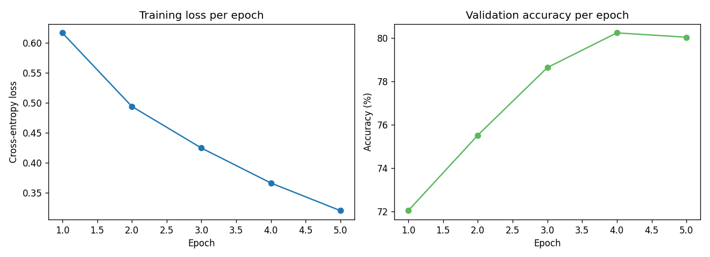

# SentimentScope

A transformer built from scratch in PyTorch to classify IMDB movie reviews as positive or negative. Built as part of Udacity's AI Engineer Nanodegree, framed as a CineScope ML project to feed sentiment signals into a recommendation system.

An interactive Streamlit app (link: _add after deploying_) lets you classify single reviews or a whole CSV and see the model's training metrics.

## Project Goals

1. Load, explore, and prepare the IMDB dataset (25,000 train / 25,000 test reviews).
2. Adapt a generation-style transformer (DemoGPT) for binary classification with mean pooling and a linear classification head.
3. Train with an epoch-based loop, validating every epoch.
4. Beat 75% accuracy on the held-out test set, and expose a reusable inference interface.

## Final Results

| Metric | Value |
| --- | --- |
| Best validation accuracy (2,500 reviews) | 80.24% |
| Test accuracy (25,000 reviews) | 77.22% |
| Epochs | 5 |
| Parameters | ~4.8M |



## Takeaways

1. Two changes turn a generation transformer into a classifier: pool token embeddings into one vector, then map it to class logits.
2. Most reviews run past ~100 words, so a 128-token window only sees each review's opening. Context length is the biggest accuracy lever.
3. The provided attention is causal. Classification does not need that limit, so bidirectional attention is a promising tweak.
4. Validating each epoch and saving the best checkpoint protects against overfitting.

## Project Structure

```
notebooks/SentimentScope.ipynb   Full pipeline: EDA, dataset, model, training, testing, report
src/model.py                     DemoGPT and its building blocks (mirrors the notebook)
src/predict.py                   SentimentPredictor: loads the checkpoint, batch inference
models/sentimentscope.pt         Best checkpoint (by validation accuracy)
models/metrics.json              Test/val accuracy and training history for the app
assets/                          EDA and training plots saved by the notebook
app.py                           Streamlit app
```

## Training (Google Colab, free GPU)

1. Open Colab, set Runtime > Change runtime type > T4 GPU.
2. Run:
   ```
   !git clone https://github.com/Kalestahr/sentiment-scope.git
   %cd sentiment-scope/notebooks
   ```
3. Follow the setup guide to download the dataset, work through the notebook, and export the files the app needs.
4. Commit `models/` and `assets/`.

Colab already ships torch, transformers, and matplotlib, so skip `requirements.txt` there.

## Using the Model in Python

```python
from src.predict import SentimentPredictor

predictor = SentimentPredictor("models/sentimentscope.pt")
predictor.predict(["Loved every minute.", "Two hours I'll never get back."])
```

## Running the Streamlit App

```
pip install -r requirements.txt
streamlit run app.py
```

The app has five parts: a scrolling feed of real IMDB reviews marked with whether the model read them correctly, a game where you guess a review's sentiment against the model, a single-review classifier, a bulk classifier for CSV uploads, and a short explanation of how the model works.

## Next Steps

1. Raise `MAX_LENGTH` to 256 or 512 (update `context_size` with it).
2. Remove the causal mask for bidirectional attention.
3. Mask padding tokens out of the mean pool.
4. Fine-tune pretrained `bert-base-uncased` to target 90%+ (needs Git LFS or the Hugging Face Hub for the ~440 MB checkpoint).
